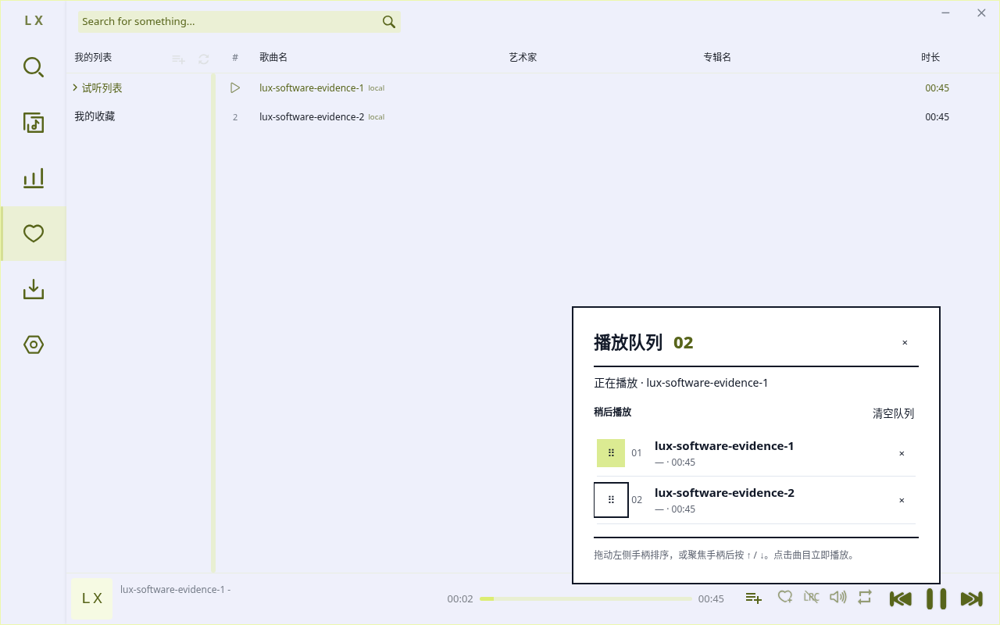
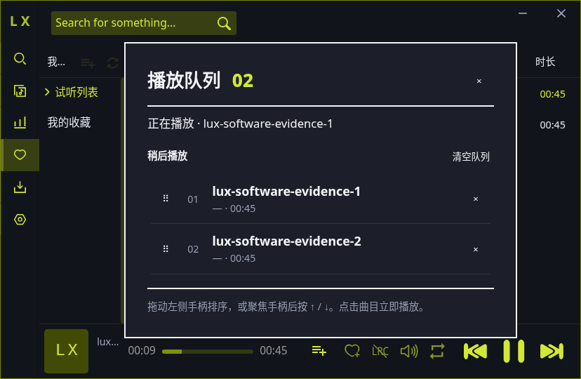

# M3c1：播放队列

PLAN 4.3 先列出 M3c 小 PR 表；本次仅交付队列，父 M3c 不勾选。基线 ac83e882 没有独立队列面板，新增播放条队列入口；原歌曲菜单、播放器、歌单及其他原入口没有移动、隐藏或删除。共享播放条只挂载一行组件。

面板沿用原稍后播放状态和 playNext 优先消费流程，以 M1 token 展示直角纸面、粗主线、细分隔、曲目编号与焦点。新增播放指定项、移除、清空、拖动和 ↑/↓ 排序，Escape 关闭并回焦点；普通歌单不变。

```sh
npm run verify
npm run evidence:prepare
LUX_EVIDENCE_MODE=queue LUX_EVIDENCE_DIR=artifacts/queue npm run evidence
```

本地最终七门检查全部退出 0：lint、typecheck、157 项测试（157 通过，0 失败/跳过）和 main/renderer/renderer-lyric/renderer-scripts 四目标构建。真实 Electron 管线 11 图（媒体 3、队列 8）通过；无 renderer 异常，进程正常退出，自有 WM 身份与清理核验通过。

通过原歌曲菜单加入两首生成 WAV，经真实鼠标拖动、键盘排序、点击第二首播放、原下一首消费剩余项、移除和清空；原生播放时钟推进、当前播放和 SQLite 来源歌单保持均已核验。mini/middle/full 的队列入口实际可用。三主题、四尺寸和原 19px 字号见下图；evidence.json 记录干净源码提交、构建及 harness 哈希、UTC、运行环境和 PNG SHA256。原始清单位于本地 artifacts/queue；PR CI 会在最终 head 重新取证并将完整构建、日志和清单保留 90 天。

| 场景 | 真实 Electron 截图 |
| --- | --- |
| 黄绿，中窗口与焦点 | [1280×800](queue-lime-1280x800.png) |
| 黄绿，窄/宽/最小窗口 | [1024×700](queue-lime-1024x700.png)、[1440×900](queue-lime-1440x900.png)、[828×540](queue-lime-828x540.png) |
| 暖米 / 墨夜 | [暖米](queue-oat_milk-1280x800.png)、[墨夜](queue-ink_night-1280x800.png) |
| 最小窗口 + 原最大 19px 字号 | [828×540](queue-font-19-828x540.png) |
| 清空后状态，当前播放保留 | [空队列](queue-empty-1280x800.png) |




Linux Xvfb/私有 D-Bus/自有 xfwm4；生产 Electron、IPC、SQLite 和原生媒体元素，临时隔离数据且禁止公网。仅系统文件选择器返回夹具路径；没有注入队列或替换媒体方法，没有模拟声卡。Windows/macOS 输入、字体、声卡/扬声器听感及生产在线音源仍需真机验证；详情、歌词、评论及其他弹层留待后续 M3c 小 PR。
