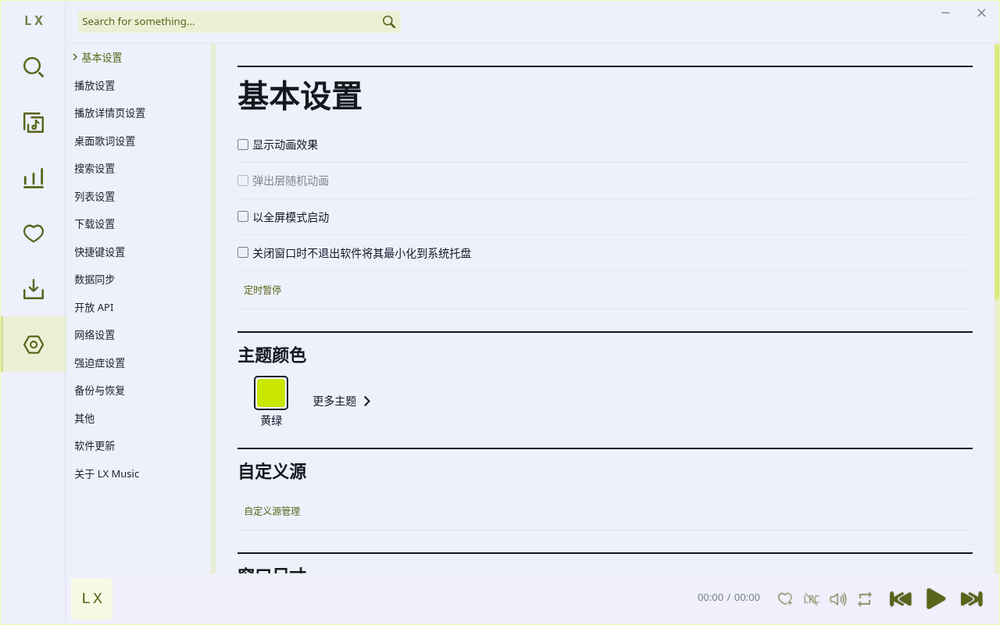
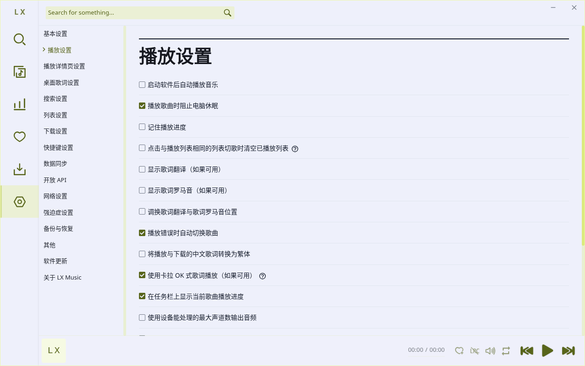
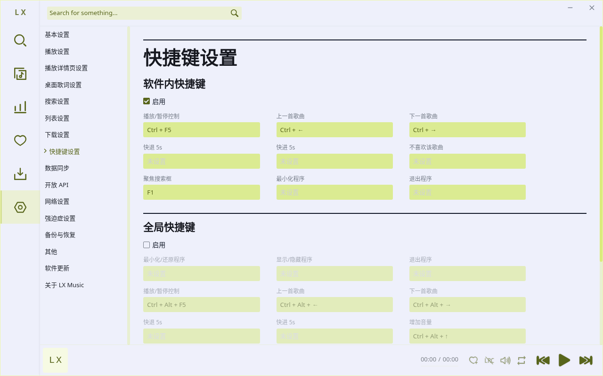
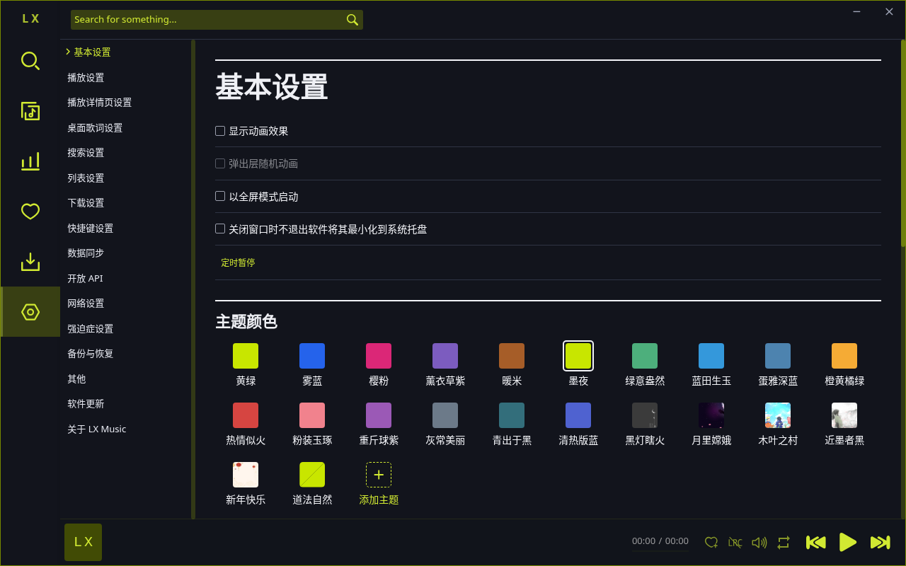

# M3d1：设置公共分组

本 PR 只改 `views/Setting/index.vue` 的公共容器、标题和行样式，使用 M1 的 paper/display/ink/rule/hairline、字号/间距 token。原目录、分类顺序、路由、设置项、条件显示和事件绑定保持；没有新增、移动、隐藏或删除入口。用户字体沿用原设置，不强制换字体。父 M3d 尚未完成。

## 功能保留核对

对照 PLAN 2.2 设置功能保留表：设置首页 template/script 与基线逐字节相同，`components/` 下 36 个文件逐字节相同。真实 Electron 逐一点击以下 16 分类，并逐个滚动检查当前平台渲染的控件中心可见且可命中；清单与数量见 `evidence.json`，CI 完整原始清单在 artifact 的 `artifacts/settings/manifest.json`。

| 原分类 | 保留的入口/能力（未改模板和行为） |
| --- | --- |
| 基本设置 | 动画、全屏、托盘、定时停止、主题/编辑/自动主题、自定义源、窗口/字体/语言、来源名、窗口按钮位置、播放条样式 |
| 播放设置 | 自动播放、播放进度、歌词翻译/罗马音、错误跳过、输出设备/声道与音质；macOS 状态栏歌词条件保留 |
| 播放详情 | 歌词缩放、延迟滚动、进度调节与对齐 |
| 桌面歌词 | 启用、显示/交互、字体/颜色/位置等；平台条件保留 |
| 搜索设置 | 热搜、历史、自动聚焦 |
| 列表设置 | 原列表行为与滚动选项 |
| 下载设置 | 启用/跳过/路径/并发/换源/命名/封面与歌词嵌入/歌词下载和编码 |
| 快捷键设置 | 本地/全局启用与全部原快捷键输入 |
| 数据同步 | LX 启用、服务端/客户端、地址/端口/设备列表；不启用服务或生成连接码 |
| OpenAPI | 启用、LAN、地址/端口和帮助入口；不启用服务 |
| 网络设置 | 代理开关、主机和端口 |
| 强迫症设置 | 自动清空搜索框/搜索结果选项 |
| 备份与恢复 | 列表/配置/全量导入导出、文本/CSV 导出 |
| 其他设置 | 透明窗口、托盘主题、缓存清理、不喜欢列表与列表数据清理 |
| 更新 | 原自动更新、版本/检查更新及日志入口 |
| 关于 | 原版本、上游/协议/文档等链接与说明 |

源管理、主题编辑、原生文件对话框等内部交互仍由后续小 PR/测试角色验证。本次滚动命中检查不等同于实际导入、恢复、联网、全局快捷键或平台专有功能通过。

## 真实截图与复现

```sh
npm ci --ignore-scripts
npm run verify
npm run evidence:prepare
LUX_EVIDENCE_MODE=settings LUX_EVIDENCE_DIR=artifacts/settings LUX_EVIDENCE_SIZES=1280x800,1024x700,1440x900 npm run evidence
```

原生产 `dist/main.js`、renderer、IPC 和 SQLite worker 在 Linux Xvfb/私有 D-Bus/自有 xfwm4 上运行；临时空 profile、禁用公网，不使用个人账号、源或文件。首尺寸保存 16 分类；基本设置另拍窄/宽窗口、暖米/墨夜及原最大 19px 字体。搜索历史开关由原 label 鼠标输入切换，经原 IPC 写盘并恢复。

关键截图入库，完整原始日志/构建/清单由 PR CI artifact 保留 90 天；`evidence.json` 记录源码、构建/harness 哈希、运行环境、UTC、窗口/主题、检查摘要及每张 PNG SHA256。






Windows/macOS 的原生窗口、字体、文件选择器、托盘、音频输出、桌面歌词及平台专有设置尚需真机验证。截图所示空/离线状态不能证明线上音源、真实下载或账号同步。
